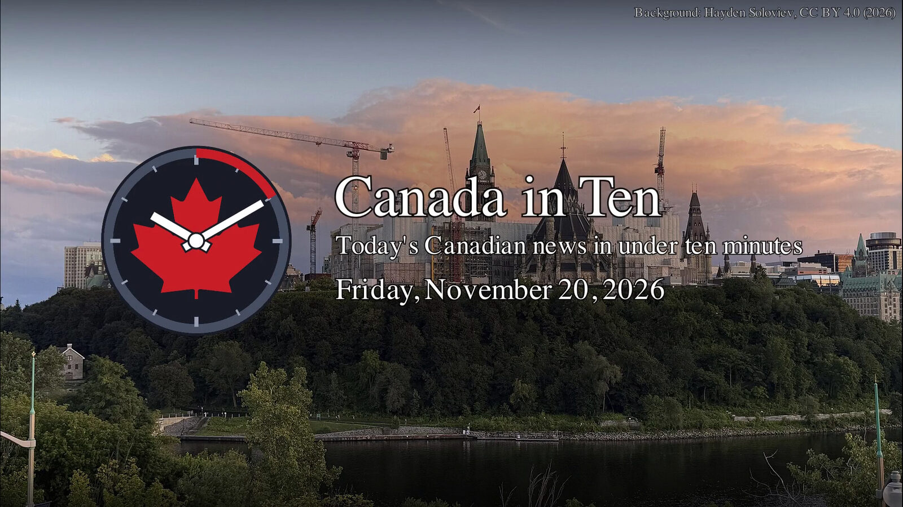
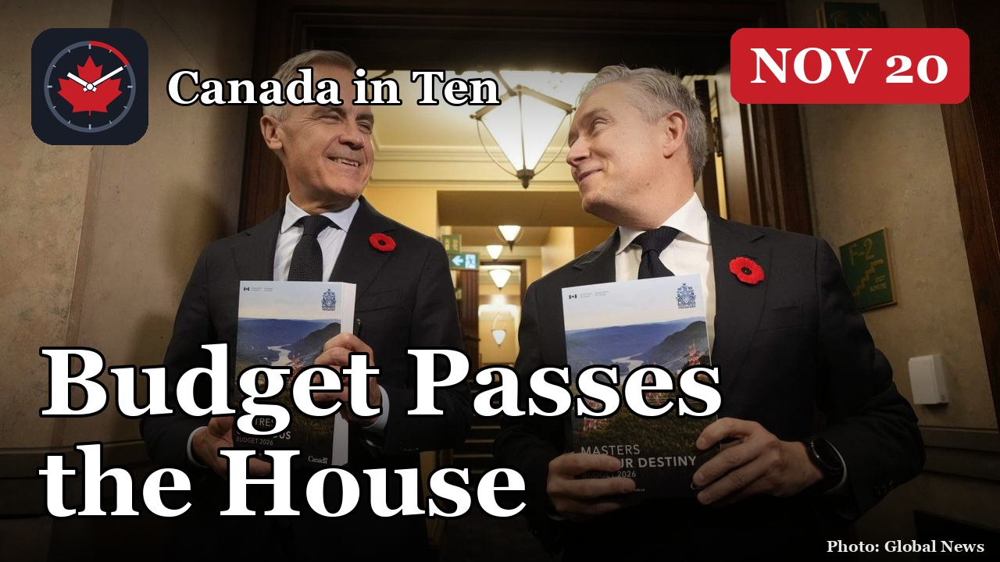
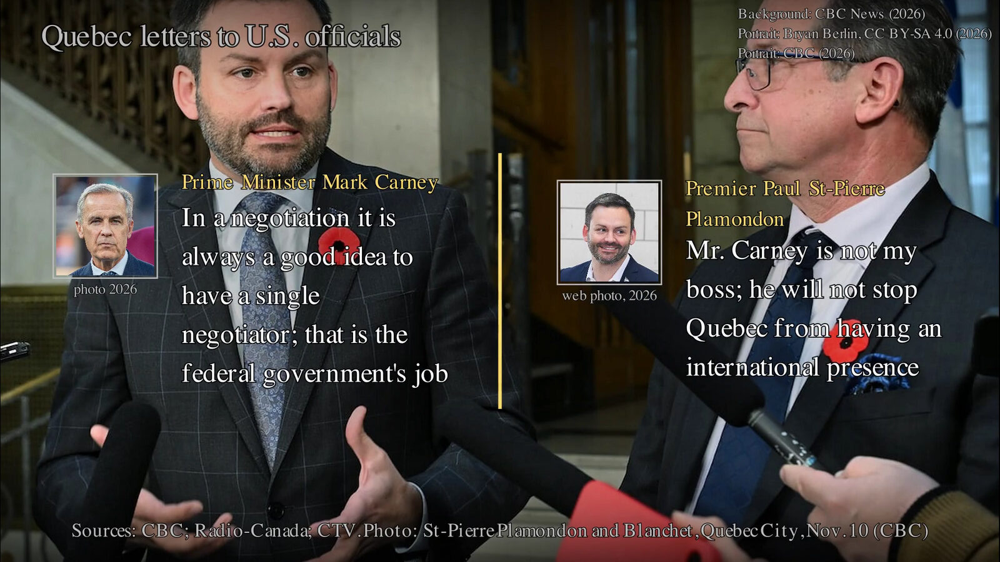
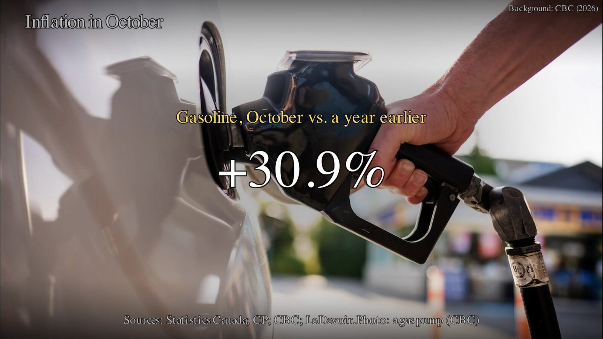
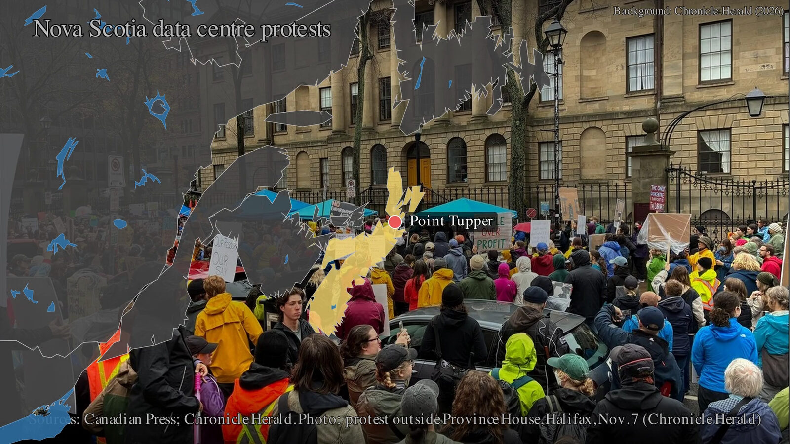
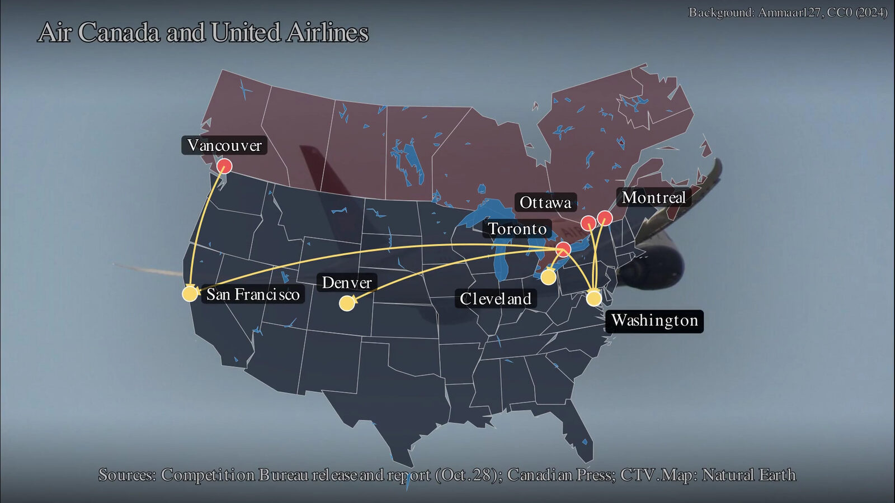
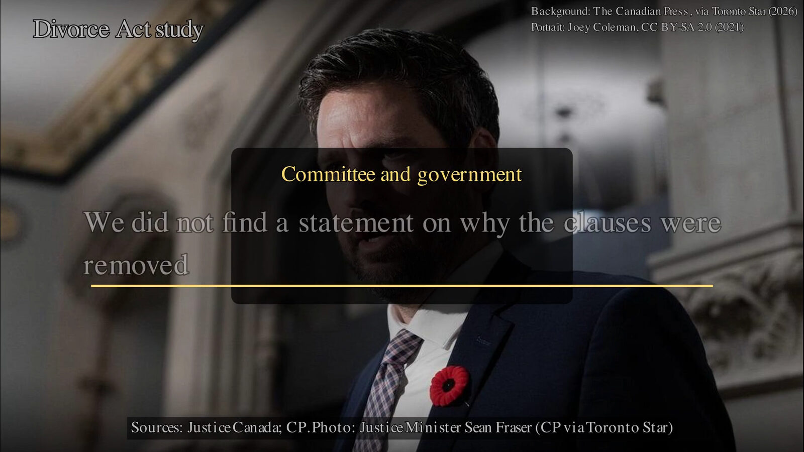

There used to be a simple way to keep up with the news. After work, around 6 or 11, you turned on the TV to the evening news and in under half an hour you had a broad idea of what had happened that day. Then the program ended, and you didn't need to look again until the same time next day.

Now news is available and pushed 24/7, on smart phones and social media. A lot of what looks like news is written to get a click, rather than to inform. I may be looking at the past with rose-tinted glasses, but I seem to recall the news of decades past being primarily to inform, and stating multiple viewpoints, leaving it up to the audience to decide what to think. Things feel very different now.

For the last few years I wondered whether I could make a version of that old evening news myself. Recently I did: a daily news video of about ten minutes, made by an AI agent and the scripts it wrote, from scouring and summarizing multiple sources. First, why I wanted it, then how it works.

## Tuning Out

Here's what I think went wrong, roughly in the order it happened.

**24-hour news:** CNN launched on June 1, 1980, as the first 24-hour news network, and it became the model during the [1991 Gulf War](https://www.mediapost.com/publications/article/352064/continuous-cable-news-was-created-40-years-ago-thi.html). Canada followed: [CBC Newsworld in 1989](https://amp.cbc.ca/archives/when-cbc-newsworld-launched-in-1989-1.4763338) and the CTV news channel in 1997. Fox News and MSNBC both arrived in 1996. A channel that is on all day needs something to say all day, even when nothing new has happened.

**9/11:** The attacks on September 11, 2001, changed how many people watched. Cable news audiences [jumped](https://www.upi.com/Odd_News/2001/10/03/News-from-the-entertainment-capital/67611002137963/) and the habit of [checking in at set times](https://www.yahoo.com/lifestyle/9-11-attacks-upended-appointment-040100425.html) began to give way to leaving the news on.

**The internet, social media, smart phones, unlimited data:** Facebook introduced the [News Feed in 2006](https://digiday.com/publishers/showing-people-want-timeline-facebooks-recent-news-feed-tweaks/) and the Like button in 2009. The iPhone arrived in 2007. A story could now reach you wherever you were, all day, and every outlet was competing with every other outlet, and with your friends' posts, for the same few seconds of attention. A [2017 study](https://pmc.ncbi.nlm.nih.gov/articles/PMC5514704) of more than half a million tweets found that each moral-emotional word in a message raised how much it was shared by about 20 percent. A [2018 study in *Science*](https://mitsloan.mit.edu/press/false-news-spreads-widely-and-easily) found that false news spread farther and faster than true news on Twitter. The incentive to alarm or anger people got baked into the system.

**Opinion mixed with reporting:** For a long time newspapers kept opinion and editorializing in a dedicated Op-Ed section, *separate* from the reporting section. My feeling is that over the last decade or so this line has blurred. This [2018 Pew survey](https://www.journalism.org/2018/06/18/distinguishing-between-factual-and-opinion-statements-in-the-news/) found that only 26 percent of Americans correctly labeled five plainly factual news statements as factual, and they leaned toward calling statements they agreed with "factual".

**Predictions:** Another kind of story I have become wary of is the prediction. "Expert says AI could take all jobs by 2030." "Analysts expect the Bank of Canada to hike interest rates." These kind of headlines have the shape of news but no event behind them. They're written to make you worry or hope, which is essentially clickbait. In my experience predictions nearly always turn out wrong, and nobody goes back to say so. I wrote about this in [AI Predictions, Fear, and Focus](TODO LINK).

**Declining trust:** The [Reuters Institute's 2025 Digital News Report for Canada](https://www.cem.ulaval.ca/wp-content/uploads/2025/06/dnrcanada2025e.pdf) found that 39 percent of Canadians trust most news most of the time, the lowest since Canada joined the survey in 2016 (the peak was 58 percent in 2018). 69 percent said they had limited their news exposure at least occasionally, up from 55 percent in 2017. Among those who avoid news, 51 percent said the news hurts their mood, 35 percent said they were worn out by the amount of it, and 30 percent said it was untrustworthy or biased.

I was one of those people. I had tuned out almost all news except tech. If you only want to know what is going on, quickly, it had become hard to do.

## Inspiration

One day I discovered [The NewsWorthy](https://www.thenewsworthy.com/), a podcast whose tagline is "fast, fair, fun". The host is a former TV news reporter who left a ten-year career in 2017 to start it. The episodes are under ten minutes, they try to cover more than one side of a story, and they do not tell you what you should think.

Another influence is Paula Pant's podcast **Afford Anything**, in particular the monthly [First Friday episodes](https://affordanything.com/episodes/?search=%22First+Friday%22). They start from official numbers, such as the Bureau of Labor Statistics jobs report, and explain what the numbers mean without using them to alarm.

The third is [Tech Brew Ride Home](https://www.techbrew.com/welcome), a daily tech news show that comes out in the late afternoon, after the day's headlines are out, so you can catch up on the way home from work. You hear what happened, and then you are all caught up for the day.

What all three gave me was a feeling I had not had from news in a long time: being calmly and efficiently informed. However, all three are focused on the United States. I looked for a Canadian equivalent and couldn't find it.

## Idea

Since I couldn't find a Canadian version, I thought about making one myself. But a fair, just-the-facts summary needs many sources: outlets with different viewpoints, plus primary sources like Statistics Canada data, court decisions and parliamentary votes. Collecting and comparing all of that every day would be a full-time job, and I didn't have the time. Then, in the last year, AI agents became capable enough to take on big projects. I realized an agent might be able to do this work. And while I was at it, why not make it a video, with illustrations to go along with the stories?

So I wrote a prompt describing the show I wanted and gave it to Claude Code (Opus 5.5, medium effort). Here is a trimmed down version:

> I want a daily 5 - 10 minute video with news from Canada covering national level, then provincial, and municipal for big cities if anything noteable. The style should be "just the facts", from multiple news sources perspectives to try and avoid one-sided bias. We should not spout opinions or try to influence the audience, we just want to inform.

> We should strive for:
> - objectivity
> - curiosity
> - context

> We need to avoid:
> - click baiting
> - fear mongering
> - outrage baiting
> - political activism and op/ed masquerading as journalism
> - heavy bias towards one side or the other
> - trying to influence readers opinion rather than stating facts

For the visuals I suggested photos of the locations being covered, and a map of Canada that highlights the region where a story is unfolding and then zooms in closer.

## How it works

That prompt was the starting point. Over several sessions Claude turned it into a runbook: a file of steps and rules it follows every day, plus Python scripts it wrote for each step. Now I type one line, "Canada news for today", and it works through these steps in order:

**Collect**

A script reads the feeds of over 100 sources listed in `sources.toml`: This includes national broadcasters, newspapers, regional papers, French-language outlets, independent outlets, government and parliamentary sources, political parties, unions and other organizations.

**Choose**

From that list, Claude picks the day's stories: national first, then provincial and municipal, with a spread across provinces. Its rules decide what runs:
- A story needs an official record or two independent owners. Two outlets with the same owner count as one, and wire copy counts as one however many sites print it.
- Only today's news, and nothing repeated from the last three days unless there is a real update.
- Facts that happened, not forecasts. A scheduled event can be stated as scheduled, such as a vote on the calendar.
- A local crime runs only if it is bigger than a local event and covered by multiple sources.

**Record claims**

A claim is one fact the script will state, such as who said what, a number, or a date. Claude writes each claim to a file with its source and the exact words on the page that support it. A script then checks that those words really are on the saved page. Below is one claim from the Stelco story's file, `episodes/2026-10-28/stories/stelco-update.json`:

```json
{
  "id": "stelco-update#2",
  "text": "Cleveland-Cliffs chief executive Lourenco Goncalves said in a television interview that he bought Stelco because it was undercutting his company's prices in the United States.",
  "status": "single",
  "basis": "statement",
  "sources": [{"ref": "article:stelco-update__cbc", "quote": "..."}]
}
```

Each story has one file holding all of its claims. A claim is `agreed` when an official record or two outlets with different owners support it, and `single` when only one does; a `single` claim is worded as what a person or group said, never as plain fact.

**Search for other perspectives**

Claude searches for the same story covered by multiple sources such as: French-language outlets, independent outlets, regional outlets where it happened, the parties, unions and companies involved (on their own sites), and official records (a court ruling, Hansard, Statistics Canada). It tries at least two phrasings for each and writes down what it found, or "none found" with the searches it tried. A check script stops the run when a story that rests on one outlet has no such record.

**Write the narration**

Claude writes each story sentence by sentence in plain spoken words, with numbers written out as they are said and acronyms spelled out so the text-to-speech voice reads them correctly. Terms a general viewer may not know get a brief definition. If one side's statement was not found, the narration says so. The result is saved as `script.md`. Here's a snippet from October 28:

> Turning to air travel, the Competition Bureau says a proposed deal between Air Canada and United Airlines would likely raise fares. The Bureau is an independent federal agency that enforces competition law. ... Transport Minister Steven MacKinnon will decide whether to approve it. We did not find a statement from Air Canada or United today.

**Photos**

When someone is quoted on screen, Claude looks for a licensed photo first, from Wikipedia and Wikimedia Commons. If that fails, or the photo is old, it falls back to Duck Duck Go image search. If a company is being referred to it will search for their official logo to display.

**Review**

A subagent reviews the script: It starts fresh with none of the first one's notes or reasoning, so it judges only what the first one wrote. It checks the script against the rules and writes a report, and the main Claude session fixes what it finds.

For example, in a story about a student march in Montreal. The draft said:

> ... five days of protest against government austerity measures, conditions in colleges and universities, and the cost of living.

The reviewer wrote:

> "austerity measures" is the organizers' description, stated in plain voice ... The government has not called its measures austerity, and the definition that follows then reads as the show's own finding.

The final version:

> ... five days of protest against what the organizers call government austerity, conditions in colleges and universities, and the cost of living.

Note the subtle but important change: "*what the organizers call government austerity*". The draft stated, in the show's own voice, that the government's measures are austerity, which is the protesters' view. The final version reports the same view and makes clear whose it is.

**Build**

After the narration script has been reviewed and updated, a text-to-speech (TTS) model reads it aloud. Claude looked at several free options and recommended [Kokoro](https://huggingface.co/hexgrad/Kokoro-82M), a small open model (about 82 million parameters, Apache 2.0 licence) that runs on my laptop with no cloud service. It reads the script one sentence at a time and saves how long each sentence takes. Since the voice sometimes mispronounces names, each episode has a `pronunciations.json` that maps a words to their phoenetics, for example:

```json
{
  "Plamondon": "Pla-mon-don",
  "St-Pierre": "Sahn-Pee-air",
  "Champagne": "Sham-pain",
  "McGuinty": "Mcghinty",
  "CBC": "C B C",
  "Nunavut": "Noo-na-voot"
}
```

The saved sentence times drive the animation, so a picture appears when the sentence that names it starts. Claude renders a quick low-resolution version, turns it into contact sheets (a grid of frames), and looks for text running into other text or off the edge of the screen. Then it renders the final 1080p video, and ffmpeg joins the picture and the audio and adds the chapter markers.

Each episode comes in under ten minutes. The rules give a word budget of about 100 to 200 spoken words per story, which the voice reads at roughly 150 words a minute, so a day fits five to eight stories.

## Putting it on YouTube

Once it worked, I decided to share the episodes as a YouTube channel. That meant a name and a look. I chose "Canada in Ten", and Claude drafted logo options. I asked for a clock with a maple leaf, and I had the idea that the opening should draw the clock's red arc from zero to ten minutes while the voice says the name and the tagline, "Today's Canadian news in under ten minutes."



For the video thumbnail, Claude suggested the lead story's photo, the logo and the show name at the top left, the date in a red tag at the top right, and the lead story's headline in large type across the bottom. Here's the one for the November 20 episode, when the federal budget passed.



The last manual chore was uploading. For every episode I had to upload the video, type the title, paste the description and upload the thumbnail by hand, and it was getting tedious. I asked if it could be automated. Claude suggested the YouTube Data API. A script now takes the video from the episode's folder and fills in the title, the description (the story list, the source links and a short "how this was made" note), the chapter markers and the thumbnail. The channel is [@CanadaInTen](https://www.youtube.com/@CanadaInTen).

TODO: Mention that it's clearly marked AI generated in the description.

## What it looks like

While the narration tells the story, the video has a few features that illustrate particular aspects of it. Below are a few examples:

**Two sides of a dispute.** When a story has two parties disagreeing, each gets its own half of the screen, with a portrait and a quote. In the November 11 episode, a story about Quebec's letters to U.S. officials shows Prime Minister Mark Carney on the left and Premier Paul St-Pierre Plamondon on the right.



**Numbers.** When the story turns on a figure, the number is shown large with a label saying what it measures. In the November 16 episode, a story about October inflation shows that gasoline cost 30.9% more than a year earlier.



**Maps.** When a story is about a place, a map highlights the region and marks the spot, so a viewer who has never heard of it can see where it is. In the November 9 episode, a story about data centre protests in Nova Scotia marks Point Tupper on a map of the province.



**Routes.** When a story is about a path between two places, arrows connect them on a map. In the October 28 episode, a story about Air Canada and United shows ten routes between Canadian and U.S. cities as curved arrows.



**Saying what we did not find.** When a side has not been heard, the show says so explicitly. In the November 19 episode, a story about a Divorce Act study says it did not find a statement from the committee or the government on why some clauses were removed.



## Limitations

This process has some shortcomings. It mostly reads what free web pages will serve. Many outlets are behind a paywall, so for those it often gets the headline and not much else. Paying for some subscriptions would give it more to choose from.

The rule that every story needs an official record or two separate outlets keeps out things that rest on one outlet's word. The same rule can also drop a real story that only one reporter has covered so far.

The script is checked by a second AI session, not by a person. The rules catch a lot, but mistakes can still get through.

## What changed for me

- feel informed without spending hours in clickbait
- satisfying to have an idea and be able to build it in a reasonable amount of time (before AI something like this would have been months long side project or maybe never have time at all)
- encourage readers to explore try out build their ideas that might not have seemed practical before, maybe now it is

## TODO

- in sources: distinguish between "news outlet" vs "primary" like statistics canada, federal court docs, others? is this distinguished in `scripts/sources.toml`?
- explain why not sharing the code - fyi written in python with manim for animations, not so important when ai agents are writing the code, judge more by the outcome than the code
- conclusion needs work
